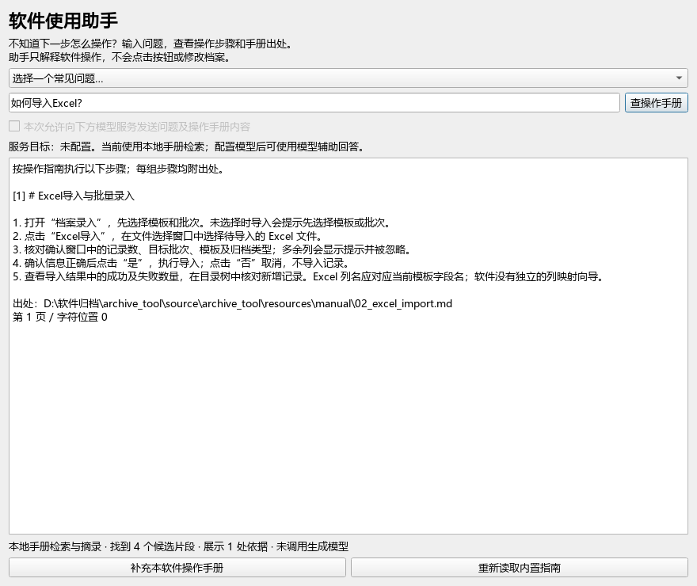
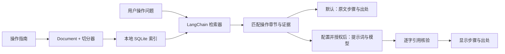

# 档案著录智能辅助工作台（最小版本）

在原 PySide6 桌面应用上增量扩展，原 SQLite 著录、JSON 字段模板、必填/日期格式校验、草稿和 Excel 导入导出流程继续使用。源码位于 `archive_tool/`；旧发布目录中的 EXE 不包含本次改动，需要从源码启动或另行重新打包。

## 新增：软件使用助手

启动源码版后，在左侧点击 **软件使用助手**。助手自动准备 7 篇随软件提供的操作指南，可以直接问“如何导入Excel？”“怎么导出当前批次？”“如何恢复草稿？”或选择常见问题。回答显示操作步骤、手册文件、页码和字符位置；没有依据时明确提示证据不足。此入口在各业务页面都可以打开。



指南按当前源码的按钮和流程编写，覆盖录入、Excel 导入/导出、草稿、校验、OCR 和检索；不是第三方正式操作手册。例如实际导入功能按模板列名处理数据，没有列映射向导。可用“补充本软件操作手册”追加资料。为便于保守匹配，每个操作节应以操作名称开头并列出编号步骤；自由排版、没有标题和编号的手册可能被拒答，需要整理资料。

操作手册使用独立的 `archive_tool/data/manual.sqlite3`，复用原知识库的解析、切分、本地索引、检索器和出处结构；不读取档案记录或字段值，不自动执行任何软件操作。工作线程处理索引和提问；处理中会禁用重复操作并阻止关闭。

### LangChain、RAG 和 Agent 分别体现在哪里

| 阶段 | 当前调用的框架组件 | 实际代码 |
|---|---|---|
| 文档与出处 | `langchain_core.documents.Document` | `assistant/parsing.py` |
| 分段及字符位置 | `RecursiveCharacterTextSplitter` | `assistant/index.py` |
| 词法与本地 LSA / 可选嵌入检索 | `BaseRetriever` 的子类 `ArchiveRetriever` | `assistant/retrieval.py` |
| 操作手册检索链 | `RunnableLambda → ArchiveRetriever → local_answer` | `assistant/manual.py:ask_manual` |
| 可选的检索增强模型回答 | `ChatPromptTemplate → 模型接口适配器 → 引用核验` | `assistant/manual.py`、`assistant/services.py:complete_prompt` |
| 桌面入口 | 主窗口“软件使用助手” → `ManualDialog` → `ask_manual` | `ui/main_window.py`、`ui/components/manual_dialog.py` |

默认模式完整执行检索和证据摘录，**没有调用大模型生成答案**。配置 `chat_model` 并在窗口明确勾选后，模型才接收问题和检索到的手册证据，选择并排列操作步骤；步骤必须逐字匹配引用原文，否则整体退回本地摘录。模型不自由编造操作。可选 `embedding_model` 接收该操作手册库的文本，不接收档案字段和档案原文。状态栏明确区分“本地手册检索与摘录”“模型辅助回答”和是否调用生成模型。

因此可以描述为“基于 LangChain 的操作手册检索问答，支持可配置的受约束 RAG 模型链”。当前尚无模型选择工具、执行动作或自主规划，不应描述成已完成的操作 Agent。模型分支通过模拟接口验证，尚未接入真实服务评测；本地检索已经实际运行。



手册专项验证命令：

```powershell
python -m pytest tests -q
python evaluation/manual_eval.py
python evaluation/manual_demo.py
```

本次共 **27 项测试通过**。手册专项问题集有 7 个可回答问题和 2 个无答案问题；两种检索的 Recall@1 / Recall@3 均为 1.0，无答案问题在两种模式下都拒答。数据量很小，题目和指南均由开发阶段编写，不能代表生产准确率，也没有证明混合检索优于基线。实际输出及逐字引用在 `evaluation/manual_results.json`，核对记录见 `evaluation/manual_review.md`。截图脚本仅在临时目录建索引，不接触档案数据库；截图使用 Windows 微软雅黑字体。

## 项目来源与贡献范围

本仓库是 [XXiangZZ/file-with-agent](https://github.com/XXiangZZ/file-with-agent) 维护的独立增强版，基于共同开发项目 [wordsandideas/code](https://github.com/wordsandideas/code)，从原项目提交 `72be23b2d42fc35c989575233a9d27d3740c2849` 继续开发，并保留原有完整 Git 提交历史与作者署名。

原项目提供档案著录、模板、校验、草稿、扫描预览、PaddleOCR 和 Excel 导入导出基础。本增强版新增 LangChain 文档切分与检索链、本地知识库、带出处的规范摘录问答、字段建议与确认回填，以及对应测试、脱敏评测和运行说明。原系统属于共同开发成果，不将其全部归为增强版维护者的独立贡献。

原项目未提供根目录 LICENSE 文件；本仓库不擅自为原有代码重新指定开源许可证。原有代码和随附第三方模型的使用与分发条件，仍以原作者约定及各自许可说明为准。

## 运行

本次验证环境：Windows、Python 3.11.9、PySide6 6.11.1、PaddleOCR 2.9.1、PaddlePaddle 2.6.2、NumPy 1.26.4。推荐新建虚拟环境，不改动已有生产环境。

在本 README 所在目录执行：

```powershell
python -m venv .venv
.\.venv\Scripts\Activate.ps1
python -m pip install -r archive_tool/requirements.txt -r archive_tool/requirements-assistant.txt
.\launch_workbench.ps1
```

已有依赖可直接安装 `requirements-assistant.txt`。启动脚本为旧 Paddle 设置 protobuf 的纯 Python 兼容模式；也可以在启动前自行设置 `PROTOCOL_BUFFERS_PYTHON_IMPLEMENTATION=python`。辅助依赖使用 LangChain Core 的真实 `Document`、`BaseRetriever`、Runnable 链，以及 LangChain 的递归切分器，不是依赖占位。

程序继续使用源码目录 `archive_tool/data/archive.db`。仓库已含历史数据库，测试不会以它为测试库。知识库另存为 `archive_tool/data/knowledge.sqlite3`；不会迁移或修改发布目录 `../data/archive.db`。正式使用前应备份自己的档案数据库，并明确要启动哪个版本。

### 本地 OCR

原项目历史包含 OCR 模型文件，本增强版保留它们；若下载方式遗漏大型模型文件，或希望复用已有发布包，请指定完整模型目录，包含检测、识别和方向三个子目录的模型及参数文件：

```powershell
$env:ARCHIVE_OCR_MODEL_DIR = '完整路径\models\paddleocr'
.\launch_workbench.ps1
```

若本仓库位于旧发布目录的 `source` 子目录，启动脚本会自动找到相邻的 `_internal/models/paddleocr`。辅助解析器不自动下载模型；缺失权重会提示失败并保留旧索引。Windows 下模型目录含中文时，为兼容 Paddle 2.x 原生加载器，将模型复制到临时目录后加载。系统临时目录也需为 Paddle 可读取的路径。

PDF 逐页提取文本，无文本页才 OCR。图片支持 PNG/JPEG/BMP/TIFF（含多帧），文本支持 UTF-8 TXT/MD，TXT 中换页符保留页号。少量文本覆盖在扫描图上的混合 PDF 不会自动整页 OCR，需人工核查；本版本不解析 Word/Excel 知识库资料，原应用的预览和 Excel 功能不受影响。

## 演示步骤

1. 启动后进入原“档案录入”，选择“文书”模板及自己的测试批次。点击“查规范 / 字段建议”。
2. 保持适用范围“文书”，导入 `evaluation/fixtures/rules.txt`、`manual.txt`、`ocr_errors.txt`。`manual.txt` 可选择“手册”；文件类型由导入时明确指定。所有资料都是人工构造测试文本，不是正式标准。
3. 把 `contract.txt` 以“合同”范围导入。将 `sample.txt` 以“样例”导入。样例不会被当成规范问答证据；合同资料不会在文书范围被检索。
4. 询问“文件题名如何填写”“跨页题名和副题名如何处理”；查看逐字摘录、来源文件、页码和片段起始字符位置。询问“档案密级如何确定”会返回证据不足。
5. 重复导入不变文件应跳过。修改测试文件后再次导入会替换该文件索引；也可删除选中资料或重建索引。不会监视磁盘文件变化；文件修改后必须重新导入。重建单文件失败保留该文件旧索引，并显示失败清单。
6. 点击“选择档案原文并获取建议”，选择 `sample.txt`（或先在原预览打开该文件，再选“从当前预览原文获取字段建议”）。查看题名、日期、责任者及对应原文。原文只在本机解析，不导入规范库，也不发送给模型。
7. 建议默认不勾选。勾选所需字段，点击确认回填并确认弹窗。仅填空字段；已有值不会被覆盖。然后使用原有校验、保存、导出功能。取消确认不会写入，确认回填本身也不会保存数据库。
8. `evaluation/fixtures/sample_scan.png` 是同一脱敏样例的人工生成图片，可用完整本地权重验证 OCR。它不是来自真实档案的扫描件。

## 可选模型与嵌入服务

复制 `archive_tool/config/assistant.example.json` 为同目录 `assistant.local.json`。聊天与嵌入可以使用不同的 OpenAI-compatible 服务地址和模型名；Ollama 可通过 `http://127.0.0.1:11434/v1` 接入。配置文件只填写密钥环境变量的名称，密钥本身由 `ARCHIVE_CHAT_API_KEY` / `ARCHIVE_EMBEDDING_API_KEY` 或配置中的环境变量名读取。`ARCHIVE_CHAT_BASE_URL`、`ARCHIVE_CHAT_MODEL`、`ARCHIVE_EMBEDDING_BASE_URL`、`ARCHIVE_EMBEDDING_MODEL` 和 `ARCHIVE_MODEL_TIMEOUT` 可覆盖本地文件配置。示例文件中的模型名为空，默认不发起请求；本地配置已加入忽略规则。非本机端点要求 HTTPS。

默认不调用任何模型服务。辅助窗口显示服务目标；每次打开窗口均需重新勾选允许发送。允许时发送的是问题及所选范围的知识库文本（嵌入会发送该范围全部规范/手册片段），不发送字段建议使用的档案原文。LangSmith 自动追踪在问答链调用内明确关闭。请不要将未脱敏档案作为规范导入后再授权外部服务。

未配置时：中文字符关键词余弦为基线；混合检索使用同义词扩展、字符/二元组 TF-IDF 与本地 SVD 潜在语义分析（LSA）加权组合。它不是预训练中文语义模型，不能承诺复杂语义理解。索引文本和元数据保存在本地 SQLite；LSA 在查询时基于当前语料重新计算，适合小型资料库，大库尚未优化。

配置嵌入模型并勾选后：导入时保存分块向量，查询时将向量得分与词法得分组合。档案规范问答可调用聊天模型生成逐句带引用的结构化回答，再经过本地词项支持检查和配置服务的支持判断；操作手册问答只从检索证据中选择逐字编号步骤。引用和支持检查不能代替业务人员判读。模型超时、不可用或嵌入失败时退回本地检索摘录；导入失败时原索引保留，界面会尝试仅用本地索引导入。当前未使用真实外部服务验证质量或兼容性。

配置聊天和嵌入模型后，可用脱敏合成手册运行显式冒烟验收；此命令会向配置服务发送合成文本和问题：

```powershell
python evaluation/real_model_smoke.py --allow-model-calls
```

脚本验证导入、持久化向量、混合检索、聊天生成及引用原文匹配。若未配置模型，可省略授权参数确认脚本不会请求服务；pytest 中的完整链路测试使用 mock，不代表真实模型效果。

## 测试和评测

```powershell
python -m pytest tests -q
python evaluation/run.py
python evaluation/evaluate_b.py
python evaluation/feedback_regression.py --db archive_tool/data/knowledge.sqlite3
$env:PROTOCOL_BUFFERS_PYTHON_IMPLEMENTATION = 'python'
$env:ARCHIVE_OCR_MODEL_DIR = '完整路径\models\paddleocr'
python evaluation/check_ocr.py
```

评测结果见 `evaluation/results.json`，逐题引用核对与限制见 `evaluation/human_review.md`。6 个可回答问题计算宏平均；另有 1 个无答案问题单独检查拒答。跨页题把两个来源页都列为相关，Recall 是召回相关页比例。

| 本次本地实测 | Recall@1 | Recall@3 |
|---|---:|---:|
| 关键词基线 | 0.8333 | 1.0000 |
| 混合检索 | 0.8333 | 1.0000 |

这组人工小样本没有测出混合检索整体提升，不代表生产准确率。OCR 错误题使用人为注入错字的文本；另一次真实 Paddle OCR 冒烟结果见 `evaluation/ocr_result.json`，只验证一张人工生成图片可解析，不能计算真实扫描件准确率。未测生产吞吐、延迟或业务效益。

## 实现清单与边界

## B 档工程化升级记录

查询链增加确定性查询改写、字段/手册/规范意图路由、关键词与向量候选融合，以及基于词项覆盖、标题匹配和范围类型的本地重排。重排是可解释的规则评分器，不是交叉编码器；脱敏小样本中没有测出相对关键词基线的 Recall 提升。

向量按服务地址、模型名和维度记录。切换嵌入模型后查询会报告索引失效；对原资料重新导入或在本次明确允许发送文本后重建，可更新向量。相同文件和切分版本的重建会保留既有向量。界面显示每份资料的向量状态。

两个辅助窗口都支持“有帮助/无帮助”和纠错记录。反馈、回答、引用和服务失败样本保存在各自的本地知识库 SQLite 中；`evaluation/feedback_regression.py` 会重放负面反馈与失败查询，检查引用来源并输出相关性词项重合度，纠错仍需人工核对。

`evaluation/evaluate_b.py` 使用 7 个开发者编写的脱敏问题实际运行本地链路。当前实测关键词与混合模式均为 Recall@1 0.8333、Recall@3 1.0000、答案相关性词项重合代理 0.5820、证据页对齐代理 0.8462、无依据问题拒答率 1.0000、引用原文真实性 1.0000（13 条引用）。混合模式与关键词模式在该样本上结果相同。相关性与证据页对齐均是代理指标，不是语义忠实度；评测没有真实聊天或嵌入模型参与。

## A 档 RAG 升级记录

本次升级新增了四个可验证能力：

- 导入阶段调用配置的嵌入服务，把每个切块的向量、模型名、维度和 chunk id 持久化到知识库 SQLite 的 `vectors` 表；增量导入、删除和重建会同步维护向量。
- 查询阶段通过 LangChain `BaseRetriever` 读取已保存的向量，只为问题生成查询向量，并与词法得分融合得到 top-k 证据。
- 配置聊天模型后，LangChain 检索链把问题和多条证据交给模型生成结构化 JSON，可综合证据回答；未配置或服务失败时继续使用本地证据摘录。
- 生成结果中的每个事实句必须声明证据 chunk id，并通过本地支持度检查；引用显示来源文件、页码、字符位置和原文片段。验证失败会拒绝该答案，不会显示未经支持的结论。

默认仍不调用外部服务。只有用户在窗口中明确勾选外部模型，并配置嵌入/聊天模型时，才会发送相应范围的知识库文本。没有真实模型服务时，本地检索和字段建议功能不受影响。

- `assistant/parsing.py`：分页解析、已有 OCR 复用、模型缺失与空文本处理。
- `assistant/index.py`：SHA-256 增量判断、原子替换、本地独立 SQLite、类型/范围/来源/页码/位置/导入时间、删除和版本失效重建。
- `assistant/retrieval.py`：LangChain 检索器、词法基线、本地 LSA 混合及可选配置嵌入。
- `assistant/generation.py`：LangChain 检索→证据摘录链；明确标签的题名/日期/责任者提取，日期真实性及歧义检查，证据不足拒绝建议。
- `assistant/services.py`：可选模型/嵌入接口、凭据环境变量、超时、逐字引用校验。
- `assistant/form_fill.py` 与辅助窗口：后台处理、进度、失败提示、处理中防重复操作与关闭、默认未选建议、用户确认后仅回填空字段。
- `assistant/manual.py` 与 `ui/components/manual_dialog.py`：内置操作指南、手册类型过滤、章节匹配、步骤出处、可选 LangChain 模型回答及失败回退；在主窗口提供各页面可见的“软件使用助手”入口。
- `tests/`：索引、PDF/OCR 适配、范围、拒答、引用、歧义、真实录入页确认流程、后台状态、原校验与 Excel 导出回归。均使用临时测试数据库。

自由文本中没有明确标签的复杂题名/落款不做自动推断。尚未支持任意问题的自然语言归纳、规范冲突裁决、扫描图中文字高亮定位、大型向量库或中途取消 OCR。单文件重建原子提交，整库重建不是一个大事务；单个失败会保留其旧索引。已有索引保留导入时快照，来源文件改变后需重新导入；不以旧文件位置冒充实时文件状态。
